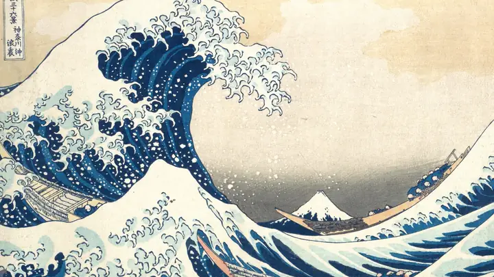
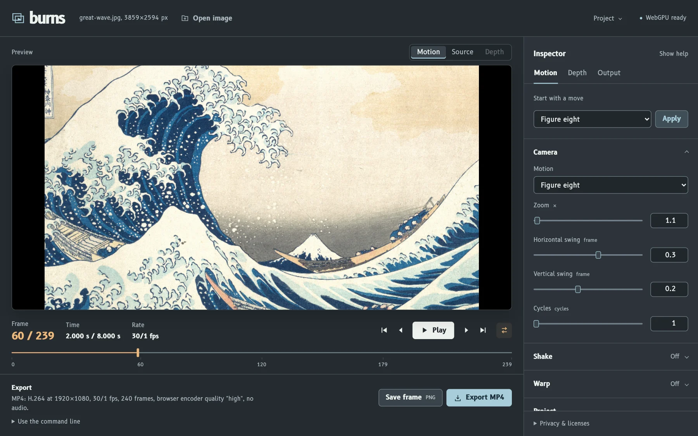

<div align="center">
  
  <h1>burns</h1>
  <p>Make a still move.</p>
  <p><a href="https://kylegrantlucas.github.io/burns-rs/">Open the workbench</a></p>
</div>

<p align="center">
  <picture>
    <source media="(prefers-reduced-motion: reduce)" srcset="docs/media/great-wave.jpg" />
    
  </picture>
</p>

<p align="center"><sub>Hokusai's <a href="https://www.metmuseum.org/art/collection/search/45434">The Great Wave</a>, animated from <a href="docs/media/great-wave.jpg">one still</a> with the figure-eight preset.</sub></p>

burns turns a photo or illustration into a short moving clip. Pick a camera move,
play it back, and adjust it until it feels right. Export an MP4, or save the frame
that catches your eye.

## Shape the move

Start with one of 16 presets, from a slow Ken Burns drift to a handheld wobble.
You can change the framing, layer in shake, or add a ripple or heat shimmer.
Scrub to any frame and adjust it while paused.

Orbital and dolly moves use a depth map to travel through the image. Load your
own or let burns estimate one on your device. Save a project to reopen the same
move in the browser, desktop app, or command line.



## Run it locally

[Nix](https://nixos.org/download/) provides the build tools and media dependencies:

```sh
git clone https://github.com/kylegrantlucas/burns-rs.git
cd burns-rs
nix develop
```

### In your browser

```sh
pnpm --dir site install --frozen-lockfile
just site-serve 8472
```

Open [localhost:8472](http://127.0.0.1:8472), drop in an image, and choose a move.
The workbench has camera controls, depth inspection, a frame scrubber, and MP4
and PNG export. It runs locally; there is no account to set up.

### On your desktop

```sh
just gui "still image.png"
```

The desktop workbench has the same motion settings, with native file dialogs
and movie export through FFmpeg.

### From the command line

Try the included public-domain print:

```sh
just cli render -i docs/media/great-wave.jpg -o great-wave.mp4 --preset figure-eight
```

Swap in your own image, choose another preset, or load a saved project. Use
`just cli presets` to see the available moves.

Building your own tool? The [Rust library](docs/reference.md#rendering-from-rust)
handles the rendering, too.

## Your images stay with you

Photos, depth maps, and exports stay on your device, including in the browser.
The first time you generate depth, burns downloads a roughly 99 MB model and
runs it locally. You can also supply your own map.

The browser needs WebGPU. MP4 export depends on your browser's encoder; the
command line can render the clip with FFmpeg. Depth comes from a single image,
so larger camera moves can expose stretched or mirrored edges.

## Reference

The [technical reference](docs/reference.md) covers every preset, project files,
command-line options, building from source, and using burns from Rust.

## License

[MIT](LICENSE-MIT) or [Apache-2.0](LICENSE-APACHE), your choice. Font, runtime, and
model notices are listed in the [technical reference](docs/reference.md#license).

The demo uses Katsushika Hokusai's [*The Great Wave*](https://www.metmuseum.org/art/collection/search/45434),
from The Metropolitan Museum of Art (JP1847). The image is
[public domain, released under CC0](https://www.metmuseum.org/openaccess).
